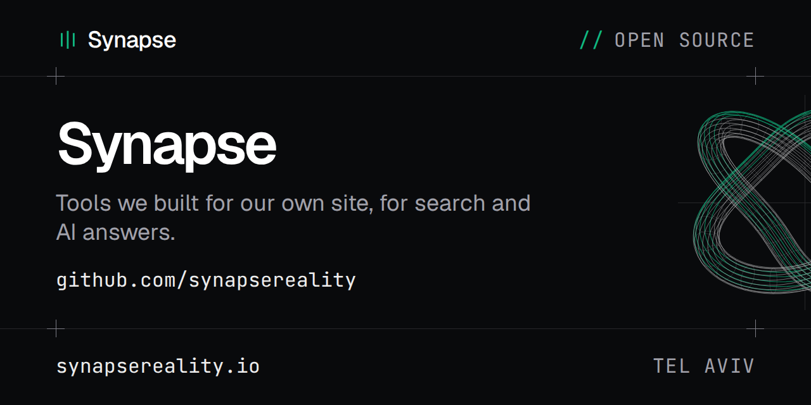

Synapse (Synapse Research Ltd, Tel Aviv) builds software and the search demand for it.
These are tools we wrote for our own site and then made general.

## Tools

| Tool | What it does | Docs |
|---|---|---|
| [answer-engine-benchmark](https://github.com/synapsereality/answer-engine-benchmark) | Asks ChatGPT, Gemini, Perplexity and Claude your buyers' questions, three times each, and counts how often they cite you. Python. | [synapsereality.io/open-source/answer-engine-benchmark](https://synapsereality.io/open-source/answer-engine-benchmark/) |
| [answer-crawler-check](https://github.com/synapsereality/answer-crawler-check) | Fails your build when robots.txt blocks an AI answer crawler from any page in your sitemap. Node.js CLI and GitHub Action. | [synapsereality.io/open-source/answer-crawler-check](https://synapsereality.io/open-source/answer-crawler-check/) |
| [one-hop](https://github.com/synapsereality/one-hop) | Checks a redirect map after a site move: every old URL must reach its new URL in one permanent redirect. Python CLI and GitHub Action. | [synapsereality.io/open-source/one-hop](https://synapsereality.io/open-source/one-hop/) |

All three are MIT licensed.

## Live Tennis API

We also built [Live Tennis API](https://synapsereality.io/work/live-tennis-api/). Its SDKs,
examples and integrations are in their own organisation,
[github.com/livetennisapi](https://github.com/livetennisapi).

## Fax for Agents

We built [Fax for Agents](https://faxforagents.com/) as well. It is a fax API, a hosted MCP
server and SDKs that let AI agents send and receive faxes, with a receipt for every job.
The SDKs, the MCP server and the examples live in
[github.com/faxforagents](https://github.com/faxforagents), and the sandbox is free.

## Contributing

Bug reports and pull requests are welcome on each repo. Read
[CONTRIBUTING.md](https://github.com/synapsereality/.github/blob/main/CONTRIBUTING.md) first.
It's short. Security problems go to ben@synapsereality.io, not to a public issue
([SECURITY.md](https://github.com/synapsereality/.github/blob/main/SECURITY.md)).

## Contact

ben@synapsereality.io or [synapsereality.io/contact](https://synapsereality.io/contact/).
Everything else we have published or had merged upstream is listed at
[synapsereality.io/open-source](https://synapsereality.io/open-source/).
